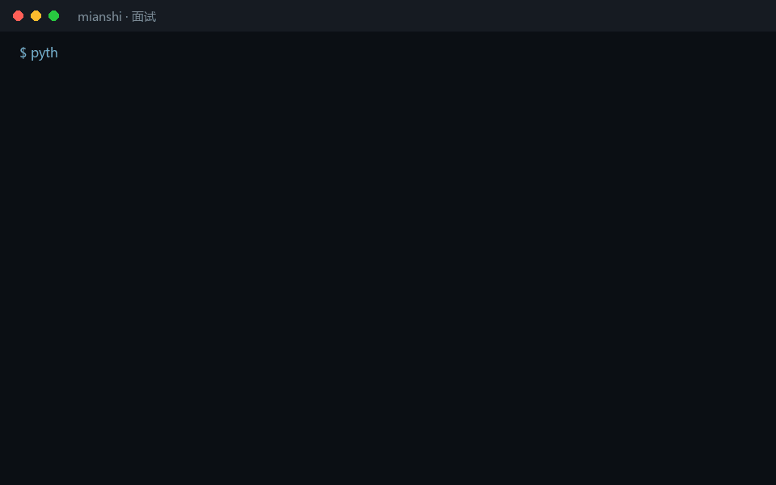
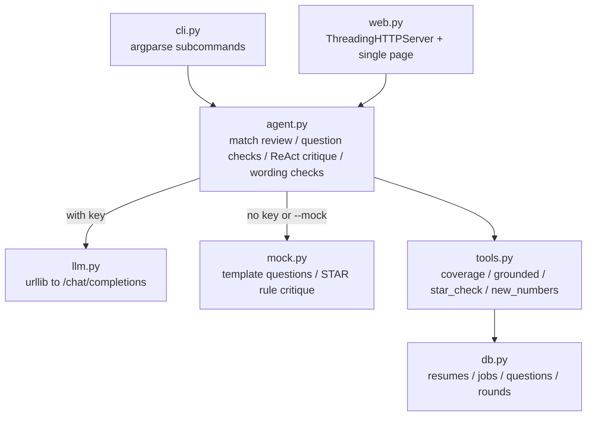

# Mianshi 面试

[](https://github.com/wushiyi105-jpg/mianshi/actions)
[]()
[](./LICENSE)
[](https://codecov.io/gh/wushiyi105-jpg/mianshi)



Drop a resume and a job description in. It tells you what is missing, generates questions the interviewer would actually ask, critiques your answers, and rewrites the vague lines in your resume.

Before an interview, what you lack is not questions but feedback. Practising alone, you always feel fine; practising with a friend, they are too polite to say you answered the wrong question. Mianshi splits it in three: the match score is computed, the questions grow out of the JD, and the critique is picked sentence by sentence from your own words.

## Features

- **Match score computed locally**: skill-term coverage counts 60%, keyword coverage 40%, giving 0–100 plus the covered and missing lists. The model writes prose and never touches this number.
- **Strengths must exist in the resume**: each "strength" is checked for an 8-character continuous run in the resume; if none is found it is dropped — models love to make experiences you never wrote sound better.
- **Questions anchored to the JD**: every question must contain a term from the JD, otherwise it is discarded; duplicates are removed; if two rounds still fall short, it says so.
- **ReAct critique**: the model may call `job_detail` for the JD and resume, and `coverage` for the breakdown, before scoring. Capped at 12 steps; no final answer means falling back to rule checks.
- **Critique only quotes you**: every `good` item must be a ≥6-character sentence from your answer; if the sample rewrite adds a number you never said, the rewrite is withdrawn.
- **Wording suggestions never overwrite**: `polish` returns `orig → new` pairs; the original must exist in the resume, the new line may not add numbers or double in length, and nothing is written back.
- **Offline mode**: match score, STAR check and vague-word scan still run; sentences are template-assembled and typography-cleaned, with an explicit note that no semantic judgement was made.
- **Two entry points**: CLI and web.

## Quick start

```bash
git clone https://github.com/wushiyi105-jpg/mianshi.git
cd mianshi
python -m mianshi resume resume.txt --title 我的简历
python -m mianshi jd jd.txt --title "AI 产品经理" --company 某公司 --resume 1
python -m mianshi analyze 1
python -m mianshi gen 1 --n 5
python -m mianshi review 1 1 answer.txt
```

With a model:

```bash
cp .env.example .env
# set LLM_API_KEY; defaults are https://api.deepseek.com + deepseek-flash
```

```bash
LLM_BASE_URL=https://open.bigmodel.cn/api/paas/v4 LLM_MODEL=glm-4.6 python -m mianshi analyze 1
```

Web UI:

```bash
python -m mianshi web --port 8771
# http://127.0.0.1:8771
```

`data/resume-sample.json` and `data/job-sample.json` hold a data/product-oriented graduate resume and two job posts to try.

Run in Docker (the container uses the default port 8771):

```bash
docker build -t mianshi .
docker run -p 8771:8771 mianshi
```

## Command reference

| Command | What it does |
| --- | --- |
| `resume <file> [--title]` | Import a resume (≥100 chars) |
| `resumes` / `show-resume <id\|title>` / `rm-resume` | List / show / delete |
| `jd <file> --title [--company] [--resume id]` | Import a JD and bind a resume |
| `jobs` / `show-job <id\|title>` | List / show jobs |
| `analyze <job>` | Score + strengths + risks + advice |
| `gen <job> [--n 5]` | Generate and store questions (replaces old ones) |
| `mock <job>` | Show stored questions |
| `review <job> <qid> <answer-file\|->` | Critique and record a round |
| `history <job>` | Mock-interview history |
| `polish <resume-id> [--job]` | Wording suggestions (never applied) |
| `stats` / `web` | Stats / web |

Global flags: `--mock`, `--json`, `--model`, `--base-url`, `--api-key`, `--db`.

## 🤔 Why not just ask a general LLM

A general model reading a resume and a JD says "a strong match". Mianshi adds the three things it cannot:

1. **The match score is computed locally** — skill coverage and JD keywords are compared item by item, so the score is calculated rather than felt; the same resume and JD give the same score, which makes two versions comparable.
2. **Questions must come from the JD** — generated interview questions must contain JD wording; invented questions are dropped. Reviewing answers checks eight consecutive characters against the resume, so it cannot slip in experience you do not have.
3. **Resumes and application records stay local** — phone number and work history sit in local SQLite and are not uploaded; a model call sends the current resume and matching JD.
4. **Structured output** — score, strengths, risks, question list and review come back as fields you can prepare against; a chat reply is encouragement you cannot practise with.

## 🎯 Use cases

- **Scoring before applying**: run one resume against three JDs and see which role genuinely covers your skills, instead of spending time on obvious mismatches.
- **Mock interview the night before**: generate ten questions from the JD, answer them yourself, then have the model point out vague or off-topic parts.
- **Reviewing a past interview**: write down what you actually said and see where it was thin or missed the point.

## 🗺 Roadmap

- **Follow-up rounds**: one more question after each answer, like an interviewer asking "how much data did that mini-program handle".
- **STAR structure check**: whether the answer covers situation, task, action and result.
- **Role question banks**: common questions for product, operations and data, mixed with JD-generated ones.
- **Resume version comparison**: two phrasings of the same experience scored separately.
- **Shared resume with Lvzhou**: maintain it once, read it from both matching and interview advice.

## ❓ FAQ

**Where do I get an API key?**
The project ships without one. It talks to DeepSeek (`https://api.deepseek.com`) by default — set `LLM_API_KEY`; any OpenAI-compatible endpoint works.

**Where is data stored, and is it uploaded?**
Resumes, JDs and mock records are in local SQLite; a model call sends the current resume and JD, not your application history.

**Does it work without a key?**
It computes the match score locally and shows keyword gaps; question generation and review need a model.

**How do I switch models?**
Change `LLM_BASE_URL`, `LLM_MODEL` and `LLM_API_KEY`, or override with `--model`.

**Is the match score accurate?**
It is literal coverage, not a judgement of experience quality. It will not tell you whether you are good enough, but it reliably filters obvious mismatches and compares two resume versions.

## How it works



Three trade-offs:

1. **The score is not the model's.** For the same job, a model may say 72 today and 85 tomorrow, and then you cannot decide what to fix. `tools.coverage` only looks at skill and keyword hits, so the number is stable and it can tell you whether Figma or A/B testing is missing.
2. **Strengths must survive a lookup.** Models expand "wrote a 12-page PRD" into "owned the full journey from research to PRD" — prettier, but one follow-up question exposes it. `grounded` demands an 8-character run matching the original, keeping polish out.
3. **The critique is a sparring partner, not a judge.** `review` runs ReAct, letting the model read the JD and resume first, capped at 12 steps; without a final JSON it falls back to STAR rules instead of improvising. A sample answer with an extra 8% is withdrawn — reciting it in the room with a mismatched number is worse than saying nothing.

One SQLite file with `check_same_thread=False` + `threading.Lock`, default `data/mianshi.db`, overridable via `MIANSHI_DB`. Deleting a job removes `rounds` and `questions` first, so no lock is taken inside another lock.

## Layout

```
mianshi/
├── mianshi/
│   ├── __init__.py / __main__.py
│   ├── llm.py     # OpenAI-compatible client + .env loader
│   ├── db.py      # resumes / jobs / questions / rounds
│   ├── tools.py   # skill terms, coverage, grounding, STAR, number checks
│   ├── mock.py    # offline match, template questions, rule critique
│   ├── agent.py   # review, generation, ReAct critique, wording checks
│   ├── cli.py     # command line
│   └── web.py     # web UI
├── data/resume-sample.json / job-sample.json
├── tests/test_mianshi.py
├── assets/demo.gif
├── .github/workflows/test.yml
├── pyproject.toml
├── README.md / README.en.md
└── CHANGELOG.md / SECURITY.md / CODE_OF_CONDUCT.md / CONTRIBUTING.md
```

## Author

shiyi · GitHub [@wushiyi105-jpg](https://github.com/wushiyi105-jpg) · wushiyi105@gmail.com

MIT License, Copyright (c) 2026 wushiyi105-jpg
