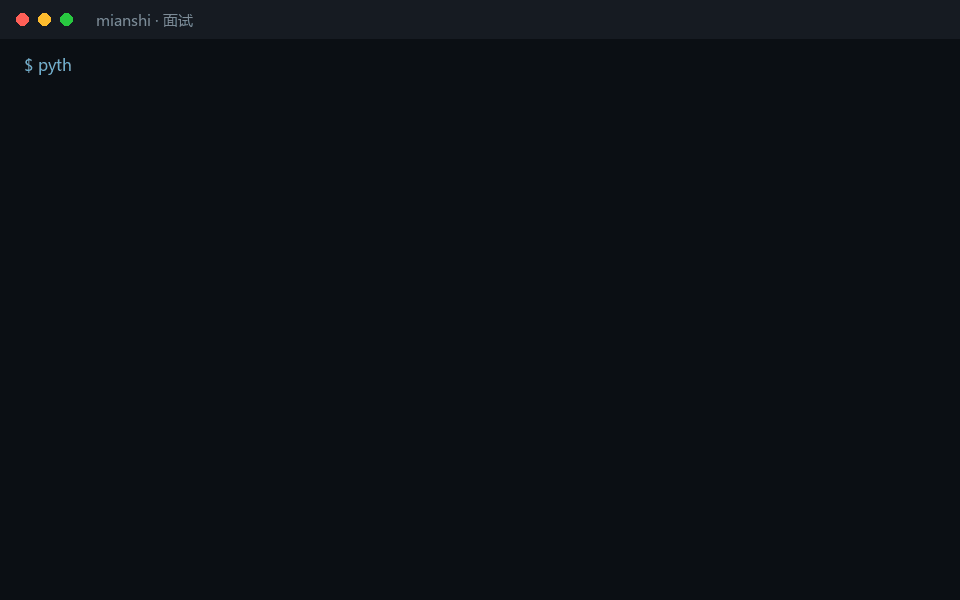
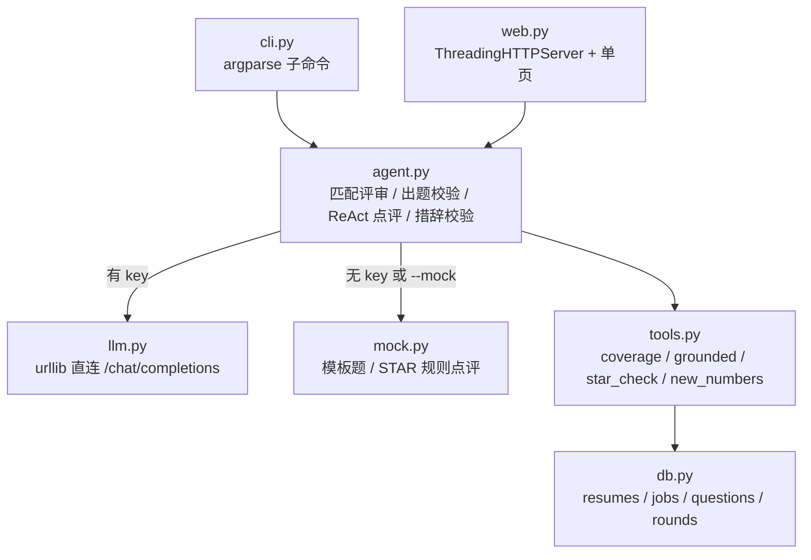

# 面试 mianshi

[](https://github.com/wushiyi105-jpg/mianshi/actions)
[]()
[](./LICENSE)
[](https://codecov.io/gh/wushiyi105-jpg/mianshi)



把简历和一个岗位的 JD 放进来,先告诉你差在哪,再按 JD 出几道真会问的题,你答完它给点评,最后把简历里那些"负责了相关工作"改成能读的句子。

面试前最缺的不是题,是反馈。自己对着空气练,永远觉得自己答得还行;找朋友练,人家不好意思说你答偏了。面试把三件事拆开:匹配度是算出来的,题是从 JD 里长出来的,点评是对着你原话逐句挑的。

## 功能特性

- **匹配度本地算**:技能词覆盖率占 6 成、关键词覆盖率占 4 成,合出一个 0–100 的分数,并列出已覆盖与缺口。模型只说人话,不碰这个数。
- **优势必须能在简历里找到**:模型的"优势"逐条做连续 8 字回查,找不到对应原句就丢掉——它很爱把你没写过的经历说得更漂亮。
- **出题落在 JD 上**:每道题题干必须出现 JD 里的原词,否则丢弃;重复题去重;两轮都不够就如实说没出到。
- **模拟点评走 ReAct**:模型可先调 `job_detail` 看 JD 与简历、调 `coverage` 看覆盖明细,再给分。上限 12 步,不给最终结果就退回规则检查。
- **点评只认原话**:`good` 每条必须是回答原文里 ≥6 字的句子;示范回答新增了原回答没有的数字,直接撤回不给示范。
- **措辞建议不覆盖原稿**:`polish` 给 `orig → new` 对照,原句必须在简历里存在,改后不许新增数字、不许长度翻倍,只打印不改文件。
- **离线模式**:匹配度、STAR 检查、模糊词仍然算;句子只做模板拼接与排版清理,明说没做语义判断。
- **双入口**:CLI 与网页。

## 快速开始

```bash
git clone https://github.com/wushiyi105-jpg/mianshi.git
cd mianshi
python -m mianshi resume resume.txt --title 我的简历
python -m mianshi jd jd.txt --title "AI 产品经理" --company 某公司 --resume 1
python -m mianshi analyze 1
python -m mianshi gen 1 --n 5
python -m mianshi review 1 1 answer.txt
```

接模型:

```bash
cp .env.example .env
# 填 LLM_API_KEY,默认 https://api.deepseek.com + deepseek-flash
```

```bash
LLM_BASE_URL=https://open.bigmodel.cn/api/paas/v4 LLM_MODEL=glm-4.6 python -m mianshi analyze 1
```

网页:

```bash
python -m mianshi web --port 8771
# http://127.0.0.1:8771
```

`data/resume-sample.json` 与 `data/job-sample.json` 是一份偏数据/产品的应届简历和两个岗位,可直接导入试跑。

## 命令参考

| 命令 | 作用 |
| --- | --- |
| `resume <file> [--title]` | 导入简历(≥100 字) |
| `resumes` / `show-resume <id\|标题>` / `rm-resume` | 列表 / 查看 / 删除 |
| `jd <file> --title [--company] [--resume id]` | 导入 JD 并绑定简历 |
| `jobs` / `show-job <id\|标题>` | 岗位列表 / 查看 |
| `analyze <job>` | 匹配度 + 优势 + 风险 + 建议 |
| `gen <job> [--n 5]` | 按 JD 出题并入库(覆盖旧题) |
| `mock <job>` | 看已生成的题 |
| `review <job> <题号> <答案文件\|->` | 点评并记一轮 |
| `history <job>` | 模拟记录 |
| `polish <简历id> [--job]` | 措辞对照建议(不写回) |
| `stats` / `web` | 统计 / Web |

全局开关 `--mock`、`--json`、`--model`、`--base-url`、`--api-key`、`--db`。

## 工作原理



三处取舍:

1. **分数不给模型**。同一个岗位,模型今天给 72、明天给 85,你就没法据此决定补哪块。`tools.coverage` 只看技能词与关键词命中,数字稳定,还能解释是缺 Figma 还是缺 A/B 测试。
2. **优势要经得起回查**。模型会把"写过 12 页需求文档"扩写成"独立完成从调研到 PRD 的全流程",读着更漂亮,但面试官追问一句就露。`grounded` 要求连续 8 字对得上原文,把美化挡在门外。
3. **点评是陪练,不是裁判**。`review` 用 ReAct 让它先看 JD 再看简历,12 步封顶;没给最终 JSON 就退回 STAR 规则检查,而不是硬编一段点评。示范回答多一个 8% 也不给——面试时你照着念,数字对不上比不念更糟。

SQLite 单文件,`check_same_thread=False` + `threading.Lock`,默认 `data/mianshi.db`,`MIANSHI_DB` 可改。删岗位时先删 `rounds`、`questions` 再删 `jobs`,避免锁里再调加锁方法。

## 目录结构

```
mianshi/
├── mianshi/
│   ├── __init__.py / __main__.py
│   ├── llm.py     # OpenAI 兼容客户端 + .env 加载
│   ├── db.py      # resumes / jobs / questions / rounds
│   ├── tools.py   # 技能词、匹配度、原文回查、STAR、数字校验
│   ├── mock.py    # 离线匹配、模板题、规则点评
│   ├── agent.py   # 评审、出题、ReAct 点评、措辞校验
│   ├── cli.py     # 命令行
│   └── web.py     # Web UI
├── data/resume-sample.json / job-sample.json
├── tests/test_mianshi.py
├── assets/demo.gif
├── .github/workflows/test.yml
├── pyproject.toml
├── README.md / README.en.md
└── CHANGELOG.md / SECURITY.md / CODE_OF_CONDUCT.md / CONTRIBUTING.md
```

## 作者

shiyi · GitHub [@wushiyi105-jpg](https://github.com/wushiyi105-jpg) · wushiyi105@gmail.com

MIT License,Copyright (c) 2026 wushiyi105-jpg
